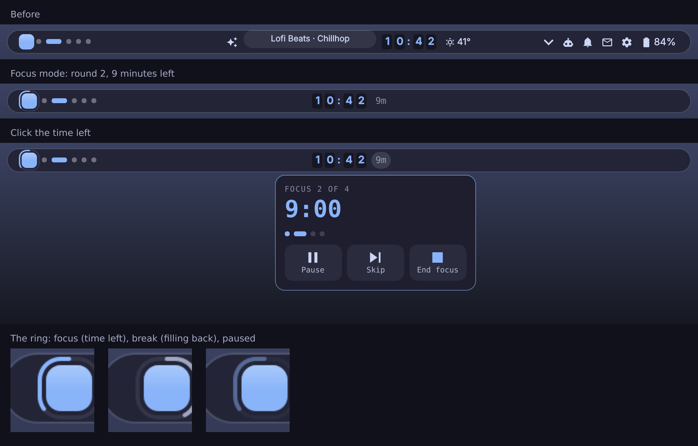

# Omabar

A floating glass bar for [Omarchy](https://omarchy.org) 4. It sits over your desktop as a flattened glass oval, follows whichever Omarchy theme you switch to, and keeps everything that already works on the Omarchy bar: panels, drag and drop, `omarchy bar` commands, and plugins.

**Left:** the Omarchy logo on a bright tile in your theme's accent color, then workspace dots. The workspace you're on stretches into an accent pill, and switching sends a drop of water across that sheds droplets and splashes into the new one.


**Center:** status indicators, the weather with the moon phase (described below), the assistant (a sparkle: hover it and a glass box drops down where you type or dictate a question, and Enter opens it in the normal chat of Claude, ChatGPT, Gemini, Grok, Claude Duet or ChatGPT Dot in your default browser, where you're signed in), a Spotify player that bulges out of the bar while a track is loaded (previous, play/pause, next, large round album art that turns while music plays, the song and artist, and a progress line), and a split-flap clock in the accent color whose digits flip like an old departures board. Click the clock for a calendar drop-down (with your Google Calendar), right-click to flip it to the date. Omarchy's world clock (Elsewhen) stays beside it, restyled with the same split-flap tiles. [Omaplug](https://github.com/fross100/omaplug) sits beside the clock when installed, so you can add and remove plugins from the bar. The center group opens with the weather: the current condition and temperature from weather.gov and, beside them, a small disc showing tonight's moon phase. It always shows, with a cloud and a dash standing in until the forecast loads or when weather.gov can't be reached. Click it for current conditions and a 5-day forecast (click any day for full day/night NWS details; right-click to refresh). The moon is worked out on your computer with no network call; hover it for the phase, how much is lit and when the next full or new moon is. Turn the moon off with `omarchy bar set omabar-weather showMoon false`, or mirror it for the southern hemisphere with `omarchy bar set omabar-weather hemisphere south`.


The player's chevron opens a playlist menu: one-click **Lofi Beats**, **Discover Weekly** and **Liked Songs** (started on shuffle), any playlists you pin, and every playlist on your Spotify account once you connect it. With Spotify closed the player rests as the Spotify logo and a chevron, so a playlist is still one click away.

**Right:** only five things stay in view: AI usage (Omarchy's agents panel, plus [ai-usagebar](https://github.com/akitaonrails/ai-usagebar) when installed), notifications, Thunderbird mail (it turns the accent color when new mail arrives in any inbox), Omarchy settings, and battery. The battery reads each pack on its own: on a ThinkPad with a removable battery (T480 and similar) the bar shows the external pack until it runs out, then the internal one, and a click shows both, the combined total, time left and the power profile. If your removable pack isn't `BAT1`, set it with `omarchy bar set omabar-battery external BAT0`. A laptop with one battery never shows an empty external slot, and the icon turns your theme's urgent color at 15% or less on battery. Everything else is folded into a drawer behind the chevron at the far left of the group. Hover it (or click to keep it open) and a glass panel drops below the bar with a tile for each control, Google Keep (your pinned notes and lists, described below), [Omaland](https://github.com/bobby-nicholas/omaland) when installed, Bluetooth, network, sound, display and keyboard layout, plus your apps' tray icons. A tile opens that control's own Omarchy panel; a tray app opens on click and shows its menu on right-click. **Edit** in the panel hides anything you don't want there. The bar itself never widens, so nothing spills over the clock.

**Focus mode:** the **Focus** tile in the drawer (or `bin/omabar-focus toggle`, which you can bind to a key) turns on Do Not Disturb, starts Lofi Beats and folds the bar down to the Omarchy tile, the workspaces and the clock, with the time left beside it. A ring traces the Omarchy tile like a clock hand: it starts full and is eaten away as a 25 minute round runs down, then draws back in a quieter color through the 5 minute break. After four rounds and a 15 minute long break, Focus mode ends by itself and everything comes back. Click the time left for the Focus card (pause, skip, end); middle-click it to end Focus mode. A soft chime and a few seconds of "Break · 5 min" mark each change.



## Requirements

- Omarchy 4 (the Quattro shell). Omabar replaces its bar; it doesn't work with Waybar on Omarchy 3.
- `jq`, `python3` and `busctl`, which Omarchy already includes. Nothing else is installed.
- Optional: the Spotify desktop app for the player, Thunderbird for the mail button, and the companion plugins below.
- Optional: `secret-tool` and a running keyring (`libsecret` and `gnome-keyring`) for Google Keep. `omabar-keep connect` installs the Keep library ([gkeepapi](https://github.com/kiwiz/gkeepapi)) into its own folder the first time.
- Network services, only when you use them: Spotify's Web API (playlist list and Liked Songs, after you connect your own Spotify developer app), Google Calendar (the secret iCal links or API you connect), Google Keep (after you connect it), and the US National Weather Service (`api.weather.gov`) for weather.

## Install

```bash
# Optional companions: install them first so setup puts them on the bar
omarchy plugin add https://github.com/akitaonrails/ai-usagebar.git --enable
omarchy plugin add https://github.com/bobby-nicholas/omaland.git --enable
omarchy plugin add https://github.com/fross100/omaplug.git --enable

# Omabar itself
omarchy plugin add https://github.com/goehringcory-lang/Omabar.git
~/.config/omarchy/plugins/goehringcory.omabar/bin/omabar-setup
```

`omabar-setup` builds the bar from the Omarchy you have installed, backs up `~/.config/omarchy/shell.json` the first time it runs, switches the shell to Omabar, lays out the widgets above, and sets the bar to glassy so Hyprland blurs what's behind it. Setup reads which plugins you have installed and places each plugin's widget exactly once: ai-usagebar beside the agents icon, Omaplug beside the clock, and every other plugin widget in the drawer panel. No widget from your old layout is carried over, so nothing doubles up. Run it again after installing a companion plugin to add it to the bar. Settings you put on Omabar's widgets with `omarchy bar set` are kept when you do.

After an Omarchy update the bar has to be rebuilt from the new shell's own. Setup installs a small hook (`~/.config/omarchy/hooks/post-update.d/omabar-rebuild`) so `omarchy update` does that for you; `omabar-setup --rebuild` does the same by hand and leaves your layout alone.

Setup checks that the shell actually loaded Omabar. If it didn't, it prints what the shell logged instead of leaving you with the built-in bar and no explanation.

### If it doesn't work

```bash
~/.config/omarchy/plugins/goehringcory.omabar/bin/omabar-setup --doctor
```

prints your Omarchy version, what Omabar built, your bar layout, and the shell's log lines about plugins. `journalctl -t omarchy-shell -b` has the full shell log.

### World clock

To pick the world clock's cities, name each one with its time zone:

```bash
~/.config/omarchy/plugins/goehringcory.omabar/bin/omabar-setup --world-clock \
  "Jonesborough, Tennessee=America/New_York" "Moyogalpa, Rivas, Nicaragua=America/Managua"
```

The world clock shows the part before the first comma as the city's name and keeps the rest as its region. `timedatectl list-timezones` lists the zone names. Setup keeps the cities through every later run, whatever id the world clock's entry had, and saves a copy in `~/.config/omabar/world-clock.json` that it puts back if the entry ever loses them. Cities you add or remove in the world clock itself are kept too.

### Spotify playlists

Lofi Beats and your pinned playlists work right away. To list every playlist on your account, open the player's menu and choose **Connect Spotify** (or run `~/.config/omarchy/plugins/goehringcory.omabar/bin/omabar-spotify login`). It walks you through making a free Spotify developer app, since Spotify requires one per user, and stores the login token in `~/.config/omabar/`, readable only by you.

Discover Weekly is a different playlist for every account, so the menu asks for your link the first time you click it.

Liked Songs isn't a playlist, and most versions of the Spotify app only open its page when asked from outside; they don't start playing. So **Liked Songs** starts them through the Spotify Web API, which needs permission to control playback. **Connect Spotify** asks for that permission along with your playlists, so if you have connected, there is no second prompt. If you haven't (or you connected with an older Omabar that didn't ask for it), the button first asks the app to play; when the app only shows the page, a terminal opens once and asks you to approve playback control in the browser, then starts your Liked Songs. Spotify only allows Web API playback with Premium; without it the button opens Liked Songs and a notification says why it didn't start.

Liked Songs only ever plays on the Spotify app on this computer. Omabar looks for the computer in your Spotify device list named after this machine's host name, which is what the Linux app calls itself, and never sends playback to your phone, a speaker or another computer on the same account. If it can't find this computer, nothing is started anywhere and a notification says so. If Spotify lists this computer under another name, run `omabar-spotify set-device` to see the names and `omabar-spotify set-device "<name>"` to pick one.

### Google Calendar

The clock's drop-down shows the month, colored dots for days with events, and the agenda for the day you pick. To fill it, open it and choose **Connect Google Calendar** (or run `~/.config/omarchy/plugins/goehringcory.omabar/bin/omabar-gcal connect`). No Google Cloud setup is needed:

1. Open [Google Calendar's settings](https://calendar.google.com/calendar/r/settings).
2. On the left, click a calendar under **Settings for my calendars**, or under **Settings for other calendars** for one shared with you.
3. Scroll to **Integrate calendar**, copy **Secret address in iCal format**, and paste it into the terminal. Repeat for each calendar, then press Enter on an empty line.

Each calendar gets one of Google's calendar colors. Repeating events, time zones, daylight-saving changes and moved or cancelled occurrences are handled. If Google can't be reached, the calendar keeps showing the last copy it loaded; if a calendar's address stops working, the drop-down names that calendar and the others keep showing. Clicking an event opens that day in Google Calendar. The addresses are stored in `~/.config/omabar/`, readable only by you. Treat them like passwords: anyone with one can read that calendar. If one leaks, reset it on the same settings page. A shared calendar shows a secret address only if its owner lets you see all event details; work accounts may have it turned off by the admin. `omabar-gcal disconnect` removes calendars.

**Calendars** at the bottom of the drop-down lists them, split into yours and shared with you. Tick the ones to show; **Add calendar** adds more.

To give a calendar a different color, click the palette beside it in that list and pick a swatch: Orange, Tangerine, Tomato, Flamingo, Banana, Sage, Basil, Peacock, Blueberry, Lavender, Grape, Graphite or Cocoa. The ring at the end puts back its Google color. From a terminal, `omabar-gcal color` walks you through it, and `omabar-gcal color "Work" orange` sets one directly (a name, the start of a name, or a `#rrggbb` color all work; `default` resets it). Your choices are kept in `~/.config/omabar/calendars.json`, which updates and `omabar-setup` leave alone.

Prefer the Google Calendar API (event colors set in Google, and every calendar at once)? Run `omabar-gcal login` instead. It needs an OAuth client of your own: in [Google Cloud Console](https://console.cloud.google.com/), enable the Google Calendar API, set up the OAuth consent screen (External, add yourself as a test user), create an OAuth client ID of type Desktop app, and paste the path to its downloaded JSON when asked. Both kinds of calendar can be used together.

### Google Keep

The drawer has a **Keep** tile. Click it for a glass card with your pinned notes and lists, each tinted in its Keep color: a list shows its open items (then "+ 2 more" and how many are checked), a note shows its first few lines. Click a note to open it in Keep, or **Open all notes in Keep** for everything else, in your default browser. The card shows the last sync at once and syncs again each time it opens; the arrow at the top syncs on demand.

Google only offers its Keep API to Workspace business accounts, so for a personal Gmail account Omabar signs in the way Keep's Android app does. Open the card and choose **Set up Keep** (or run `~/.config/omarchy/plugins/goehringcory.omabar/bin/omabar-keep connect`). A browser window opens on Google's sign-in page. Sign in, click **I agree**, and the rest happens on its own: the one-time code Google gives the browser is traded for a Keep token, and the window closes. The window uses a fresh, throwaway browser profile (Chromium, Chrome, Brave, Vivaldi or Edge, whichever you have), so it never touches your own browser's data, and it's deleted afterwards.

If that window won't sign in, or you only use Firefox, `omabar-keep connect --paste` is the manual way: sign in at [accounts.google.com/EmbeddedSetup](https://accounts.google.com/EmbeddedSetup), click **I agree**, open the developer tools (F12), copy the value of the `oauth_token` cookie under the site's cookies, and paste it right away (it works once, for a few minutes).

The Keep token is stored in your keyring (GNOME Keyring, through `secret-tool`) and never in a file. Treat it like a password: it can read your Google account the way a phone signed in to it can. `omabar-keep disconnect` removes it and the cached notes, and changing your Google password revokes it. If Google ever signs it out, the card says so; run `omabar-keep connect` again. Synced notes are cached in `~/.cache/omabar/`, readable only by you. To put Keep on the bar instead of in the drawer, move the `omabar-keep` entry from `tray` to `right` in `~/.config/omarchy/shell.json`.

### Thunderbird

The mail button turns the accent color while any inbox in Thunderbird, across all your accounts, has unread mail, and goes back once it's read. Hover it for the count. It reads the unread counts Thunderbird keeps in its profile (regular, Flatpak or Snap), whenever Thunderbird updates them or shows a new-mail alert (nothing polls), so Thunderbird needs to be running to fetch mail. Click to open Thunderbird. Without Thunderbird installed, the button hides itself. If you use a fork such as Betterbird, `omarchy bar set omabar-mail app betterbird` opens and watches that instead.

## Measure it

```bash
~/.config/omarchy/plugins/goehringcory.omabar/bin/omabar-stats -n "what this is"
```

watches the shell for ten seconds and prints its memory, its CPU, Hyprland's CPU and how often it wakes up. Each run is saved, and `omabar-stats --log` lists them side by side, so you can compare before and after an update. The bar is one part of Omarchy's shell, so the numbers are for the whole shell; measure in the same state each time (music playing or not, no drop-downs open, mouse off the bar).

## Undo or remove

To go back to your old bar and keep Omabar installed:

```bash
~/.config/omarchy/plugins/goehringcory.omabar/bin/omabar-setup --restore   # your layout from before setup
```

To remove Omabar completely:

```bash
~/.config/omarchy/plugins/goehringcory.omabar/bin/omabar-setup --uninstall
```

`--restore` and `--uninstall` put back only the `bar` section of `~/.config/omarchy/shell.json` from the copy setup saved; every other setting you changed in `shell.json` since then is kept as it is now. If you have already switched to a different bar yourself, they leave it alone.

`--uninstall` puts back the bar layout you had before setup (or Omarchy's default bar if there is no backup), removes the world clock copy setup made (a world clock copy you made yourself is kept and gets its own times back; of the backups Omarchy keeps of world clock copies, only the one made by this removal is deleted), deletes the update hook, deletes `~/.config/omabar/` (your Spotify login, calendar addresses and world clock cities), `~/.cache/omabar/` and `~/.local/state/omabar/` (ending Focus mode first if it is on), and then runs `omarchy plugin remove goehringcory.omabar` for you. Nothing of Omabar's is left behind.

If you already removed it with `omarchy plugin remove` (or from a plugin manager) and the bar looks empty, run `omarchy bar defaults` for Omarchy's default bar. The next `omarchy update` also does this for you: the update hook notices Omabar is gone, puts back your bar from before setup (keeping your other shell settings), and deletes itself. `~/.config/omabar/` and `~/.cache/omabar/` can then be deleted by hand.

## Customize

Everything is normal Omarchy bar configuration, so you can drag widgets around, move things in and out of the drawer (the layout's `tray` section), and use `omarchy bar move`, `omarchy bar set`, `omarchy plugin add`, and `omarchy plugin remove` as usual.

- **Look:** double-click empty bar space, or run `omarchy bar background opaque|glassy|none`, to switch between solid glass, frosted glass, and clear.
- **Assistant:** `omarchy bar set omabar-ask providers '["claude","gemini"]' --json` picks which sites it offers and in what order, `provider chatgpt` picks the first one shown (after that it remembers your last pick), `hover false` opens it on click only, and `links '{"duet":"https://claude.ai/…"}' --json` opens a page of your choosing for a site. Every site is asked for you, with nothing to paste: ChatGPT and Grok take the question in their link, Claude's link fills it in and Enter is pressed for you, and for Gemini, Duet and Dot `bin/omabar-ask` pastes it into the chat box and presses Enter once the browser window shows that site (it needs `wtype`, which Omarchy installs). If a page is slow and misses it, `typeDelay 4000` gives sites longer to load (default 2500 ms); if one never comes up, the question is left on your clipboard with a notice. The mic uses Omarchy's dictation (Setup > Defaults > Dictation); Alt+Space works too. Your last 20 questions (Up arrow in the box) are kept in `~/.config/omabar/ask.json`, readable only by you. **Pictures:** copy a screenshot (Omarchy's screenshot tool puts it on the clipboard) or a photo, or copy a picture file in your file manager, then press Ctrl+V in the box: it shows up as a small thumbnail (hover it for a × to take it out), up to four per question. Enter opens your chosen site, pastes the pictures and your question into its chat box and sends them once they've uploaded; a picture on its own, with no text, works too. Big photos on a slow connection may need `uploadDelay 6000` (default 3000 ms). Pasted pictures wait in `$XDG_RUNTIME_DIR/omabar-ask`, private to you, and are deleted once asked.
- **Player:** `omarchy bar set omabar-player player <name>` follows a different MPRIS player, `anyPlayer true` falls back to whatever is playing, `maxWidth 260` gives the track more room, `lofi <link>` points the Lofi button at another playlist, `showIdle false` hides the player while Spotify is closed, `bulge false` keeps it flat inside the bar, `shuffleLiked false` starts Liked Songs without turning shuffle on, and `spin false` keeps the album art still, which is the lightest setting while music plays. Pin playlists with `omarchy bar set omabar-player playlists '[{"name":"Focus","uri":"spotify:playlist:…"}]' --json`.
- **Clock:** the clock shows 12-hour time with AM/PM; `omarchy bar set omabar-clock twelveHour false` for 24-hour, `showDate false` for just the tiles. The calendar's agenda uses the same 12 or 24-hour style, and its weeks start on the day your system's region uses; `weekStart sunday` or `weekStart monday` picks one.
- **Weather:** reads the US National Weather Service (`api.weather.gov`) and drops down a 5-day forecast right in the bar, with a **Radar** button that opens the local `radar.weather.gov` station. It starts out on Yosemite Valley, so set your own location with `omarchy bar set omabar-weather url "https://forecast.weather.gov/MapClick.php?lat=…&lon=…"` (or `lat` and `lon`), `days 7` for more days, `units C` for Celsius, `radarUrl` to override the radar link, or `twelveHour false` for a 24-hour "Updated" time. The moon phase disc beside it takes `showMoon false` to hide it and `hemisphere south` to mirror it. The National Weather Service covers the US only.
- **Motion:** animations follow Omarchy's reduce-motion setting. Everything is drawn by the GPU at your display's refresh rate, antialiased and scaled with mipmaps, so it stays sharp on HiDPI screens.
- **Focus mode:** `omabar-focus set focus 50` (minutes), `shortBreak 10`, `longBreak 20`, `rounds 3`, `repeat true` to start over after the long break instead of ending, `music false` to leave Spotify alone, `lofi <link>` for another playlist, and `sound false` for no chime. Settings are kept in `~/.config/omabar/focus.json` and apply from the next start. Do Not Disturb is turned on only if it was off and turned back off at the end only if it is still on; Lofi Beats starts only if nothing is already playing and is paused at the end only if Focus mode started it. If the laptop sleeps during a round, Focus mode pauses where it was rather than skipping ahead; one left paused for 8 hours ends. A battery at 15% or less stays on the bar. To bind a key, add to `~/.config/hypr/bindings.conf`: `bind = SUPER ALT, F, Focus mode, exec, ~/.config/omarchy/plugins/goehringcory.omabar/bin/omabar-focus toggle`.
- **Workspace dots:** `omarchy bar set omabar-workspaces persistent 7` changes how many dots always show.
- **Size:** the bar height follows `[bar] size-horizontal` in `~/.config/omarchy/shell.toml`, with a 34px floor.

## How it works

Omabar is Omarchy's own bar engine with a different body. `tools/omabar-patch.py` takes the built-in `shell/plugins/bar/Bar.qml` and makes a few anchored edits: the strip floats off the screen edge, it's drawn as a rounded glass pill with a soft shadow and sheen, and it reserves room for the gap so windows, panels and notifications clear it. The plugin manifest marks it as a clone of `omarchy.bar`, the same way `omarchy plugin clone omarchy.bar` does, so it gets the built-in bar's capabilities.

Omarchy's bar changes between releases, so the engine isn't shipped ready-made. `omabar-setup` runs the patch against `$OMARCHY_PATH/shell/plugins/bar` on your machine and writes the result to `engine/`, which `Bar.qml` loads. `engine/` is ignored by git, so `omarchy plugin update` keeps working. If an edit no longer matches your Omarchy's bar, setup says so and uses `prebuilt/`, a copy built from Omarchy 4.5.0.

Focus mode is `bin/omabar-focus` (which handles Do Not Disturb and music and writes `~/.local/state/omabar/focus.json`) and one `OmabarFocusController` that the patched engine makes for the whole bar; it reads that file and tells each widget slot whether to fold. The menu tile, workspace dots, assistant, player, playlist menu, clock, calendar, weather, notification bell, mail button, battery and drawer are custom bar modules in `modules/`. `bin/omabar-gcal` reads Google Calendar. `bin/omabar-keep` syncs Google Keep with gkeepapi, which it installs into `~/.local/share/omabar/keep-venv` so nothing touches the system Python. `bin/omabar-weather` reads the National Weather Service (`api.weather.gov`) and caches forecasts in `~/.cache/omabar/`. `tools/omabar-elsewhen-patch.py` swaps the world clock's times for split-flap tiles in a clone of `omarchy.elsewhen`, which `omabar-setup` makes for you, so the built-in plugin is never touched. `bin/omabar-spotify` plays playlists through Spotify's MPRIS interface (over `busctl`, so nothing extra needs installing) and lists them through the Spotify Web API. `python3 -m unittest discover -s tests` checks the calendar reader, calendar colors, the weather helper, the Spotify helper, the assistant's links and pictures, the battery logic, the Thunderbird unread reader, the Keep helper, Focus mode's timer and helper, setup's layout, restore, `--help` and `--doctor`, and that `prebuilt/` matches the patch tool.

`preview/` holds recordings (GIF and MP4) of the workspace and clock animations, rendered from the real module code with stand-ins for the Omarchy shell.

## Credits

The bar engine (`engine/`, `prebuilt/`) is generated from [Omarchy](https://github.com/omacom/omarchy) (MIT, Copyright (c) David Heinemeier Hansson), and the workspace numbering follows its workspaces widget. See `NOTICE`.
